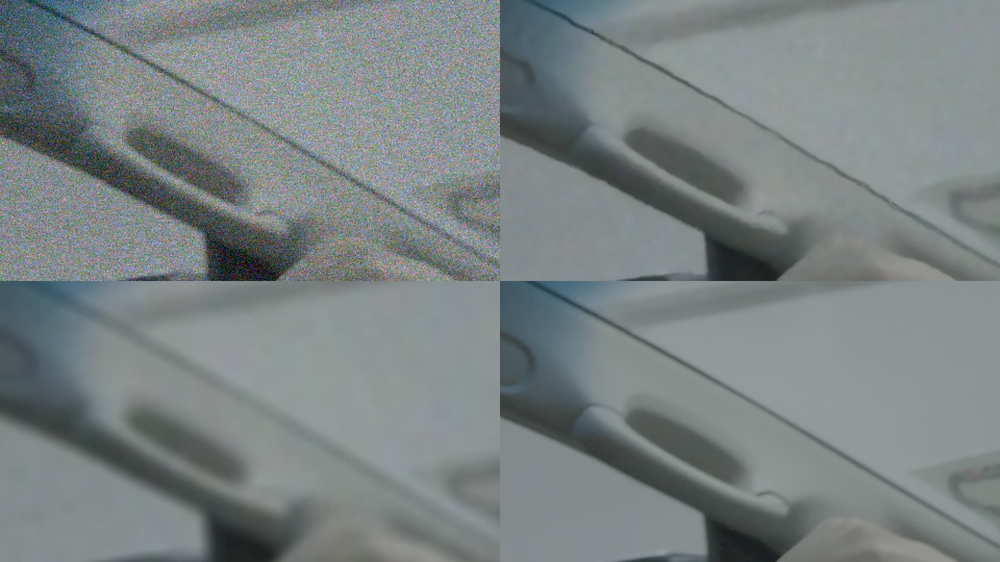
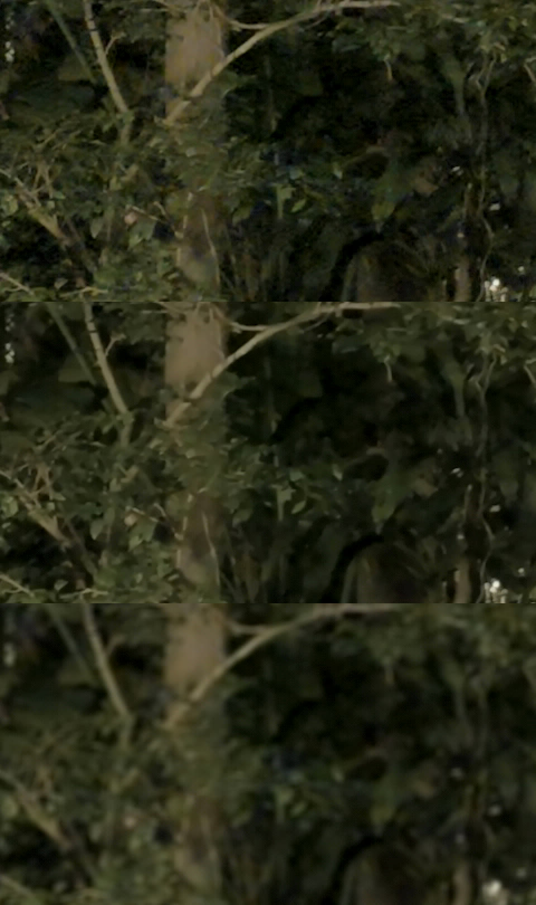

# Denoise and grain

`ffcine-filters` (kernels, parameters, timeline effects) and `ffcine-render/src/backend/denoise.rs`
(running them). Roadmap step 7 ([design.md](design.md#frame-filters)). Run on 2026-11-01, RTX
5060 Ti, shared box (other renders, whisper and llama.cpp on the same GPU, 20-60 % busy):
GPU times come from libplacebo timers and are a ceiling, wall-clock fps are noisy.

```sh
ffcine grade --temporal-radius 2 --temporal-strength 3 --denoise 1.5 --grain 2 in.mp4 out.mkv
```

| flag | meaning (strengths are noise sigmas in 8-bit code values, on 10/16-bit data) |
|---|---|
| `--temporal-radius N` | frames on each side, 1-5 (0 = off) |
| `--temporal-motion nvof\|blocks` | motion source (default nvof, falls back to blocks) |
| `--temporal-strength S`, `--temporal-chroma S` | how different a warped neighbour may be and still count as "the same pixel" |
| `--denoise S`, `--denoise-chroma S`, `--denoise-radius R` | spatial NLM after the temporal pass (chroma defaults to 1.5x) |
| `--grain S`, `--grain-size PX`, `--grain-chroma K` | film grain on the graded output |

Timeline: `ffcine.fx.denoise/1 {luma, chroma, low_light, temporal: {radius, strength, chroma}}`
and `ffcine.fx.grain/1 {strength, size, chroma}` ([timeline.md](timeline.md#effect-schemas)).

## How it runs

Per output frame, all compute on the grade's `pl_gpu` (ffmpeg's `VkDevice`), queued on
libplacebo's dispatch right before `pl_render_image`, which reads the result as its source frame.
Frames never leave VRAM and the CPU never waits on the GPU (NVOF included, below).

1. **Ingest** (each decoded frame): copy the planes into a ring of `2r+1` slots (r16/rg16, so the
   decoder's pool is released at once) and write a quarter-size luma.
2. **Motion** (per neighbour, `2r`): NVOF or Vulkan block matching (below). Each vector carries
   its block's mean absolute difference at full resolution: the match confidence.
3. **Merge** (one dispatch per plane): each neighbour is warped onto the centre with bilinear
   vectors and samples, and weighted by `exp(-max(d2 - 2h^2, 0) / h^2)` on the 3x3 patch distance
   `d2`, times a penalty when the block's MAD is above what noise alone explains. The centre has
   weight 1, so a pixel whose neighbours all mismatch (occlusion, a cut, a wrong vector) keeps its
   own value: no ghosting, just less denoising there.
4. **Spatial** (one dispatch per plane): NLM, 3x3 patch, `(2R+1)^2` search, from a shared-memory
   tile. Optional.
5. **Grain**: an mpv `.hook` on `OUTPUT`: luma-weighted Gaussian value noise, new every frame. It
   fuses into the render pass, so it costs no dispatch.

The output is `r` frames behind the input; the render thread renders frame `c` once `c+r` is
decoded and flushes the tail at the end of the shot (missing neighbours are skipped), so the
encoder gets the same frames and timestamps.

### Motion: NVOF (default) or Vulkan block matching

`--temporal-motion nvof|blocks`, `temporal.motion` in the timeline.

- **NVOF** (default): NVIDIA's optical-flow engine through ffcine-stabilize's session
  (`OpticalFlow::with_slots`, a ring of `2r+1` input frames, temporal hints off since the pairs
  aren't consecutive), medium preset, half-resolution 8-bit luma, 4x4 grid (one vector per 8x8
  luma pixels). Asynchronous: the render thread only queues work, and nothing passes through
  the host:
  - all CUDA work (copies, `nvOFExecute`) goes on one CUDA stream (`nvOFSetIOCudaStreams`);
  - Vulkan and CUDA order each other with two timeline semaphores made by libplacebo
    (`pl_vulkan_sem_create`, exported as fds, `cuImportExternalSemaphore`). Vulkan signals by
    holding a texture (`pl_vulkan_hold_ex`), which fires once every earlier use of it is done;
    CUDA's signal is waited on by releasing it (`pl_vulkan_release_ex`), so libplacebo waits for
    it before the texture's next use;
  - per pushed frame, a Vulkan pass writes the half-res luma into an `r8` texture, downloaded
    into an exported `pl_buf`; the texture is held, the stream waits for that, copies the buffer
    into the NVOF input slot (`cuMemcpy2DAsync`) and signals; the release waits for the copy, so
    the next frame's luma can't overwrite the buffer early;
  - once a frame's last neighbour is in, its `2r` flows are queued on the stream, each copied
    device to device into one of two exported flow buffers (by frame parity), then a signal;
  - NVOF runs one frame ahead: frame `c` renders once `c+r+1` is in (so `2r+2` ring slots), and
    its flows compute while frame `c-1` renders. A Vulkan pass then unpacks the flow buffer
    (S10.5 shorts) into `rg32f` textures (`x / 16`, exactly as the old host path), the
    confidence passes read them, and holding one of them tells the stream when it may rewrite
    that buffer, two frames later.
  - Before (until this change), the CPU polled the luma buffer (`pl_buf_poll`), and each
    `nvOFExecute` was followed by a synchronous readback through the host and a texture upload.
  - A Vulkan **confidence** pass then rescores it: for each 8x8 cell, NVOF's vector, its four
    neighbours' vectors and zero, keeping the lowest full-resolution MAD. NVOF regularises flat
    dark areas into arbitrary vectors; without the rescoring it lost to block matching
    everywhere (0038: 0.544 vs 0.406 temporal noise), with it it wins on ground truth.
  - Cost: GPU 4.6 ms/frame at 4K r2 (half of block matching). Before/after,
    `bench/denoise/nvof.sh` on the DJI night clip (4K 10-bit HEVC, 96 frames, r2, 3 runs each,
    values in run order; other jobs came back onto the GPU during the run, so wall fps swing
    2-4x between runs, even without denoise):

    | | render-thread ms/frame in NVOF | steady fps | GPU ms/frame (libplacebo) |
    |---|---|---|---|
    | before: poll, execute, readback | 39.2 / 17.0 / 58.9 | 23.4 / 47.6 / 14.4 | 3.2-5.6 |
    | after: queueing only | 5.5 / 7.2 / 6.4 | 32.7 / 10.6 / 27.0 | 3.5-6.5 |
    | blocks, before / after | - | 16.0 / 26.3 / 43.6, 13.6 / 18.6 / 9.1 | 4.4-17.5 |
    | no denoise, before / after | - | 10.4 / 27.9 / 41.5, 18.5 / 12.1 / 17.4 | - |

    The render thread spends 3-9x less time in NVOF (17-59 -> 5.5-7 ms/frame; what's left is
    libplacebo's submissions for the holds and CUDA's queueing), and the outputs are
    bit-identical (same frame md5s at NVENC QP 0 without dither, PSNR inf, at 4K and at 540p).
    On this shared GPU the fps are inside the noise, the baseline included; a quiet GPU is
    needed to see what the overlap buys end to end. Reproduce with
    `BEFORE=old/ffcine bench/denoise/nvof.sh CLIP SS`.
  - Falls back to block matching (with a log line) when there is no CUDA device, NVOF, or
    exportable timeline semaphore.
- **Blocks**: Vulkan block matching, one vector per 16x16 block: exhaustive SAD at quarter
  resolution, +-6 quarter pixels around a predictor (the vector to the nearer neighbour on that
  side, scaled by distance) plus +-1 around zero, then a full-resolution refine (2 px then 1 px).
  3.3 ms/frame at 4K r2, nothing outside Vulkan.

| motion | heavy noise PSNR Y/U/V, SSIM Y | mid noise PSNR Y/U/V, SSIM Y | DJI 0037 / 0038 temporal noise (4x4 bins) | 4K r2 GPU ms + NVOF wall ms |
|---|---|---|---|---|
| **nvof** (rescored) | **41.21 / 49.02 / 48.90**, 0.964 | **44.19 / 51.15 / 51.31**, 0.976 | 0.381 / 0.484 | 4.6 + 23-25 |
| blocks | 40.34 / 48.16 / 47.89, 0.965 | 43.37 / 50.25 / 50.31, 0.974 | **0.378 / 0.406** | 7.9 |
| nvof, NVOF vector only | 39.90 / 48.89 / 48.81, 0.953 | 43.55 / 51.14 / 51.31, 0.974 | 0.392 / 0.544 | 4.1 + 16 |

(temporal r2 + NLM, same settings as below.) NVOF wins where there is ground truth, by 0.8-0.9 dB
luma and ~0.9 dB chroma; on 0038 (the stillest, darkest window) block matching flattens the
boiling more. Slow preset, a sqrt contrast stretch before the 8 bits, a +-1 px refine and a
16x16 scoring window were tried and didn't help.

## Results

### Synthetic: known noise, PSNR/SSIM

`bench/denoise/run.sh`: DJI `0004` (daylight, `payday`) 0.25 s, 48 frames, downscaled to 1080p
(area) as the clean reference, plus ffmpeg `noise` (temporal, per pixel) at two levels: heavy
(PSNR 25.7 dB, luma sigma ~13 in 8-bit) and mid. Every output goes through the same ffcine grade
(no LUT, BT.709 in and out, NVENC QP 4) and is compared with the clean clip through the same
grade. White Gaussian noise is a stand-in: real low-light noise is lower-frequency after in-camera
NR and HEVC.

Heavy noise (input: Y 25.7 dB):

| filter | GPU ms/frame (1080p) | PSNR Y / U / V (dB) | SSIM Y / all |
|---|---|---|---|
| none | - | 25.70 / 30.92 / 31.07 | 0.299 / 0.380 |
| ffcine temporal r2, s16 | 1.29 | 33.88 / 39.74 / 39.94 | 0.746 / 0.800 |
| ffcine temporal r3, s16 | 1.59 | 35.02 / 41.26 / 41.43 | 0.803 / 0.847 |
| ffcine NLM only, 12/16, R4 | 1.52 | 38.22 / 47.03 / 46.92 | 0.900 / 0.929 |
| **ffcine temporal r2 s16 + NLM 8/12 R3** | 2.02 | **40.34 / 48.16 / 47.89** | **0.965 / 0.974** |
| ffcine temporal r3 s16 + NLM 6/12 R3 | 2.42 | 40.02 / 48.27 / 47.88 | 0.965 / 0.974 |
| nlmeans_vulkan s=4 p=7 r=15 | | 35.79 / 45.81 / 45.70 | 0.943 / 0.958 |
| nlmeans_vulkan s=4 p=7 r=7 | | 38.61 / 44.35 / 44.44 | 0.943 / 0.955 |
| nlmeans_vulkan s=1 p=7 r=7 (design default) | | 38.72 / 44.33 / 44.43 | 0.943 / 0.955 |

Mid noise (input: Y 31.9 dB):

| filter | GPU ms/frame | PSNR Y / U / V (dB) | SSIM Y / all |
|---|---|---|---|
| none | - | 31.94 / 37.44 / 37.66 | 0.628 / 0.699 |
| ffcine temporal r2, s8 | 1.45 | 39.48 / 45.73 / 46.01 | 0.917 / 0.937 |
| **ffcine temporal r2 s8 + NLM 4/6** | 1.59 | **43.37 / 50.25 / 50.31** | **0.974 / 0.981** |
| ffcine temporal r3 s8 + NLM 3/6 | 2.71 | 43.07 / 50.04 / 50.06 | 0.974 / 0.981 |
| nlmeans_vulkan s=2 r=15 | | 36.35 / 48.58 / 48.38 | 0.949 / 0.963 |
| nlmeans_vulkan s=1 r=7 | | 41.05 / 49.42 / 49.57 | 0.968 / 0.976 |

- Temporal + spatial beats nlmeans_vulkan alone by 1.6-2.3 dB luma and ~3.5 dB chroma, at a
  higher SSIM, and keeps edges and texture that nlmeans flattens (crops).
- Temporal alone at r2 is +8 dB; r3 adds 1.1 dB. White noise at this level needs the spatial
  pass on top: the merge only averages 2r+1 samples.
- r3 over r2 doesn't pay once the NLM runs (the clip moves; more distant frames match less).

The tables below were measured with block matching (the PR #15 version); NVOF's rows are above.



*1080p crop at 2x, frame 24: noisy, ffcine (temporal r2 + NLM) / nlmeans_vulkan, clean.*

### Real: DJI Osmo Pocket night clips

`bench/denoise/real.sh`: DJI D-Log M HEVC 10-bit 4K (`0037` at 428 s, the darkest; `0038` at
60 s, the stillest night window), 48 frames, slow walking. No ground truth, so noise is measured
on a dark flat 512x512 patch (top left): `sigma` is the robust high-pass sigma, `temporal` the mean
absolute frame-to-frame difference (what reads as "boiling"), both in 8-bit code values of the log
signal, at full resolution and after 4x4 binning (the blotchy noise HEVC leaves). nlmeans_vulkan
runs with the design's settings (`s=1:p=7:r=7:t=1`; `r=15` runs out of VRAM at 4K on this shared
card).

| clip | filter | sigma (full / 4x4 bins) | temporal (full / 4x4 bins) |
|---|---|---|---|
| 0037 | none | 0.309 / 0.665 | 1.145 / 0.748 |
| 0037 | ffcine temporal r2 s3 | 0.178 / 0.425 | 0.693 / 0.499 |
| 0037 | **ffcine temporal r2 s3 + NLM 1.5/2.5** | 0.090 / 0.250 | **0.432 / 0.377** |
| 0037 | ffcine temporal r3 s3 + NLM 1.5/2.5 | 0.083 / 0.223 | 0.383 / 0.340 |
| 0037 | ffcine NLM only 2/3 R3 | 0.098 / 0.250 | 0.507 / 0.455 |
| 0037 | nlmeans_vulkan s=1 r=7 | 0.083 / 0.254 | 0.545 / 0.484 |
| 0038 | none | 0.368 / 0.746 | 1.540 / 1.047 |
| 0038 | ffcine temporal r2 s3 | 0.188 / 0.335 | 0.698 / 0.522 |
| 0038 | **ffcine temporal r2 s3 + NLM 1.5/2.5** | 0.083 / 0.195 | **0.458 / 0.405** |
| 0038 | ffcine temporal r3 s3 + NLM 1.5/2.5 | 0.083 / 0.174 | 0.392 / 0.347 |
| 0038 | ffcine NLM only 2/3 R3 | 0.112 / 0.295 | 0.761 / 0.684 |
| 0038 | nlmeans_vulkan s=1 r=7 | 0.085 / 0.314 | 0.777 / 0.697 |

- Spatially, nlmeans and ffcine's temporal + NLM end up as flat as each other; frame to frame,
  ffcine cuts the "boiling" to 0.38-0.41 (from 0.75-1.05, 4x4 bins) where nlmeans leaves
  0.48-0.70, and it does so without the smear.
- These DJI clips are already smoothed in camera, so the absolute numbers are small in log code
  values; the night look's gamma and LUT multiply them several times.



*`0037` frame 24, 480x270 crop at 2x, lifted (gamma 1.7, contrast 1.4) to show the noise: no
denoise, ffcine temporal r2 s3 + NLM 1.5, nlmeans_vulkan s=1 r=7. nlmeans smears the leaves;
the temporal pass keeps them.*

No Canon R10 low-light footage was available: the only R10 clip (`MVI_2884.MP4`, 8-bit H.264,
daylight) has nothing to denoise. Re-run `real.sh` on R10 night clips when there are some.

### Speed

GPU time per frame from libplacebo timers (shared GPU, so upper bounds):

| | 1080p | 4K (DJI 0037) |
|---|---|---|
| ffcine temporal r2 + NLM | 1.6-2.0 ms | 7.9 ms (motion 3.3, merge 2.2, NLM 2.2, copies 0.2) |
| ffcine temporal r3 + NLM | 2.4-2.7 ms | ~11 ms |
| ffcine NLM only | 1.5 ms | 3.5 ms |
| nlmeans_vulkan s=1 p=7 r=7 t=1 | | ~56 ms (one frame uploaded once, looped 96x: 8.1 s vs 2.75 s without the filter) |

Whole `ffcine grade` at 4K (Vulkan decode, grade, NVENC), 48 frames, steady-state fps: 48 without
denoise, 39-47 with temporal r2 + NLM, 36 with r3, while other jobs used the GPU. At ~8 ms the
denoiser alone would run at ~125 fps at 4K, so a denoised render stays decode/encode bound; the
same nlmeans_vulkan pass caps a 4K render near 18 fps.

## Left to do

- Tune defaults on snow and night-sky footage (aurora:
 flat dark sky, where temporal denoise matters
  most); the strengths here are per-clip choices.
- `ffcine render` applies `ffcine.fx.denoise/1` and the grade's `denoise` number
  ([assembly.md](assembly.md#per-clip-filters)); `ffcine.fx.grain/1` isn't wired into it yet.
- Re-run `bench/denoise/nvof.sh` on a quiet GPU for end-to-end fps (the numbers above were
  measured alongside other jobs).
- Scene cuts within a shot are handled by the merge's rejection; a ring reset on detected cuts
  would save the work.
- Dolby Vision metadata is carried over per frame; ICC profiles and AV1 film-grain side data
  are dropped on the denoised path.
